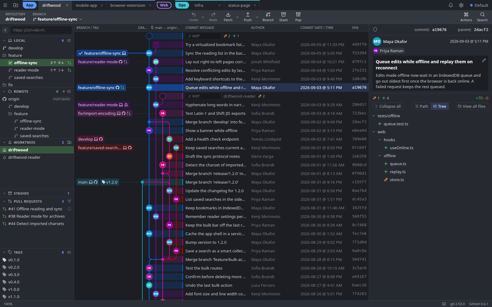

<p align="center">
  
</p>

<h1 align="center">GitBolt</h1>

<p align="center">A fast, keyboard-friendly desktop Git client with a commit graph at its heart.</p>

---

GitBolt is a graphical Git client inspired by [GitKraken](https://www.gitkraken.com/). If you've
used GitKraken, it'll feel familiar on purpose: the lane graph down the middle, the branch and
remote sidebar, the commit details on the right, and workflows driven from context menus and
the keyboard. GitBolt is an independent project, not affiliated with or endorsed
by GitKraken / Axosoft.

It's built with a Rust core (using [gitoxide](https://github.com/GitoxideLabs/gitoxide) for most reads
and the `git` CLI for writes, so your hooks, config and credentials behave exactly as they do in a
terminal), a React UI, and [Tauri](https://tauri.app/) with the Chromium (CEF) runtime.



> **Status:** early (0.x). Usable day to day on Linux and Windows, and new on macOS; expect rough edges.

## Platforms

| Platform | Status |
|---|---|
| Linux | Supported: `.deb`, `.rpm` and Arch Linux packages |
| Windows | Supported (10 and 11): an installer (per user) and an MSI (per machine) |
| macOS | Supported (12 or later, Apple Silicon): a `.dmg`. Intel Macs aren't supported |

## Installing

Download the package for your system from the
[latest release](https://github.com/GitBoltApp/gitbolt/releases/latest):

- **Debian and Ubuntu:** `sudo apt install ./GitBolt_<version>_amd64.deb`
- **Arch Linux:** `sudo pacman -U GitBolt-<version>-x86_64.pkg.tar.zst`
- **Fedora 40 or later:** `sudo dnf install ./GitBolt-<version>-1.x86_64.rpm` (openSUSE Tumbleweed:
  `sudo zypper install --allow-unsigned-rpm ./GitBolt-<version>-1.x86_64.rpm`)
- **Windows:** run `GitBolt_<version>_x64-setup.exe` (installs for you, no administrator rights)
  or `GitBolt_<version>_x64.msi` (installs for all users). They aren't code-signed yet, so
  Windows SmartScreen warns the first time: **More info** › **Run anyway**.
- **macOS (Apple Silicon):** open `GitBolt_<version>_aarch64.dmg` and drag GitBolt to
  Applications. The app is ad-hoc signed, not signed with an Apple Developer ID or notarized, so
  the first launch is blocked ("Apple could not verify…"). Either run
  `xattr -dr com.apple.quarantine /Applications/GitBolt.app` once, or try to open it, then
  go to System Settings › Privacy & Security and click **Open Anyway**.

GitBolt needs Git 2.40 or newer on your `PATH` (on Windows,
[Git for Windows](https://gitforwindows.org/); on macOS, Xcode's command line tools or Homebrew's
`git`). `SHA256SUMS` in each release lists the files'
checksums. After that, GitBolt updates itself (see [Updates](#updates)).

## Features

### Highlights

- **Code review on GitHub and GitLab.** Comment on a line or a range from the diff's gutter, in
  every diff mode and on a rendered Markdown diff's blocks; collect the comments as drafts in a
  pending review, then send them with Comment, Approve or Request changes. Suggested changes show
  as a diff of the lines they replace, and **Apply** puts one in your working copy. GitHub.com
  and GitLab, self-managed included.
- **Rendered Markdown diffs.** Read a changed `.md` file as rendered Markdown, inline or side by
  side, with the changed words highlighted.
- **Image diffs.** Side by side, swipe, onion skin and a pixel difference view, all with zoom.
- **File previews.** HTML pages render in a sandbox, CSV and TSV files show as tables with their
  rows diffed, PDFs as pages (old and new side by side), and audio, video and fonts play or
  display, each in place of a hex dump.
- **Undo history.** Each worktree keeps a journal of its last 50 operations, and it
  survives restarts: commits and amends, checkouts, branch and tag changes, merges, rebases,
  cherry-picks, reverts, resets, stashes, discards and pulls. Staging has its own undo too.
- **Interactive rebase.** Besides pick, reword, squash and drop, GitBolt has fixup
  and edit (the rebase stops so you can amend that commit), predicts which commits will
  conflict before you start, and lets you move, add or delete branches on the rewritten commits
  in the same step.
- **Stacked MRs/PRs.** Create a whole stack of merge or pull requests at once, push and rebase the
  stack, and have the next one retargeted after a merge, on GitHub and GitLab (self-managed
  included).
- **Free and MIT licensed, private repos included.** No account and no telemetry.

### Everything else

#### Graph and workspace

- **Pinned trunk.** The graph keeps your main branch and the remote branch it tracks at the left,
  sharing a lane until they diverge. In a fork, it pins the original project's trunk
  (`upstream/main`) with your main. You can pick another branch or turn it off.
- **Tabs and tab groups.** A tab for each repository or worktree. Drop a tab onto another to
  group them; a group's chip collapses it, moves it, or saves and closes it to reopen later.
- **Profiles.** Each has its own tabs, forge accounts and an optional extra git config file.
- **Worktrees.** Create one, switch to it, or open it in its own tab. Each keeps its own undo
  history and commit message draft.
- **Submodules.** The changes say whether a submodule has new commits, modified content or isn't
  initialised, and its diff names each commit. Update, sync URLs or open one in a tab.
- **Git LFS.** Diffs, File View and File History show an LFS file's real contents, never its
  pointer, with **Download** for one that isn't local yet. Pull, fetch, and track or stop
  tracking a file type from a file's menu.
- **Compare.** Pick any two commits to see what changed between them, and swap which one is the
  "from" and which the "to".
- **Find.** Search commits by message, hash or file path with Ctrl+F, older history included.
- **Go to the clipboard.** Ctrl+V outside a text field goes to what's on the clipboard: a commit
  hash, an MR/PR (`!12`, `#12` or its link), a forge's commit or file page, a file path with its
  line number, or a branch or tag.

#### Reviewing and forges

- **Pending review.** Your drafts, the summary and the verdict sit in a panel in the MR/PR view,
  and a chip in the top bar ("Reviewing !12 · 3 pending") stays in view while you browse. A
  review left pending on the web comes back when its MR/PR opens, and a part-way failure
  recovers cleanly.
- **Review threads in the diff.** Threads show as cards under their lines, outdated ones marked;
  a resolved one folds into its author's avatar in the gutter. F9 and Shift+F9 step through
  them, and the file list marks files that have threads.
- **MR/PR view.** Docked beside the graph: reply, resolve, react, edit, approve, request changes,
  change reviewers, assignees and labels, and check out (adding the fork's remote first).
  Pipeline status and the activity timeline, in rendered Markdown with Mermaid diagrams.
- **Merge panel.** Merge, or set auto-merge for when the checks pass. When the branch is behind
  its target (worked out from your fetched commits), one split button rebases it or merges the
  target in, the way you last chose.
- **Creating MRs/PRs** with templates, people and label pickers, and drafts. Committing to main
  in your fork suggests a branch first.

#### History, merges and rebases

- **Merge tool:** three-way, with an editable result and a conflict minimap.
- **File history and blame,** with each version's diff, and restore a file from any commit.
- **Cherry-pick and revert,** each with a no-commit variant; stashes; tags.
- **Signed commits** through your git config, and signature verification in the commit details.
- **Undo menu:** undo an older action out of order when nothing later depends on it.
- **Activity log** of every git command GitBolt ran, with its output, hooks included.

#### Files and diffs

- **Diffs:** inline, split or hunk, with word-level changes, syntax highlighting and sticky
  scroll. Stage and unstage files, hunks and lines from the diff.
- **Rendered HTML** as a static page in a sandbox: its scripts don't run and nothing is fetched,
  with its relative images and stylesheets read from the repository.
- **CSV and TSV tables:** the header row and row numbers stay in view, and a diff lines the rows
  up, a changed row's cells marked.
- **PDFs** as pages with selectable text; a diff shows the two versions side by side, scrolled in
  step.
- **Audio, video and fonts:** a player for each side, or a font's name, a pangram and its glyphs.
  **Hex** shows any file's bytes.
- **File View:** read a file rendered or as source, edit a working-tree file, or create one.
  **Open in** your editor, file manager or default app, old versions included.

#### Keyboard and look

- **Command palette** (Ctrl+P) with every action, and every shortcut, including the ones that
  only work in a context, in Help › Keyboard shortcuts (Ctrl+/).
- **Themes,** many built in, dark and light, with per-lane graph colours, density presets and
  app zoom.
- **Spell check,** built in, in the commit message and the MR/PR text fields.

#### Privacy

- **No telemetry,** analytics or crash reporting. The update check is the only request GitBolt
  makes on its own that isn't about your repositories or accounts.
- **Locked-down webview.** A strict Content Security Policy, and Chromium can't resolve any host
  name but localhost: the Rust core makes every network request. Images from hosts other than
  your forge load only after a click. Tokens stay in the system keyring.
  [PRIVACY.md](PRIVACY.md) has the details.

### Compared with GitKraken

✅ yes, 🟡 partly, ❌ no.

| | GitKraken | GitBolt |
|---|---|---|
| Commit graph with lanes, branch/tag chips and avatars | ✅ | ✅ |
| Main branch pinned to the left | 🟡 When you pin one | ✅ Automatic, with its remote branch and, in a fork, the original project's; can be changed or turned off |
| Tabs, multiple repos, worktrees | ✅ | ✅ Also tab groups |
| Staging files, hunks and lines | ✅ | ✅ |
| Undo / redo | 🟡 Last action only | ✅ Last 50 operations, across restarts |
| Branches, tags, stashes, cherry-pick, revert, reset | ✅ | ✅ |
| Merge and rebase | ✅ | ✅ |
| Interactive rebase | 🟡 Pick, reword, squash, drop | ✅ Also fixup, edit, conflict prediction and branch moves |
| Merge conflict tool with an editable result | ✅ | ✅ |
| Push, pull, fetch, remotes, adding a fork as a remote | ✅ | ✅ |
| Diffs: inline, split, hunk, word-level | ✅ | ✅ |
| Image diffs | 🟡 | ✅ Side by side, swipe, onion skin, difference |
| File history and blame | ✅ | ✅ |
| Rendered Markdown | 🟡 Files only | ✅ Files, diffs and MR/PR threads |
| Pull/merge requests: list, view, create, comment, approve, merge | ✅ | ✅ Also auto-merge, and updating a branch that's behind |
| Inline code review comments | ✅ GitHub | ✅ GitHub and GitLab: lines and ranges, a pending review, suggested changes you can apply |
| Stacked pull/merge requests | 🟡 GitHub.com only | ✅ GitHub and GitLab |
| Forges | GitHub, GitLab, Bitbucket, Azure DevOps; self-hosted on paid plans | GitHub.com and GitLab, including self-managed |
| Commit signing | ✅ | ✅ Through your git config |
| Signature verification | ✅ | ✅ |
| Command palette and keyboard shortcuts | ✅ | ✅ Every one listed in Help › Keyboard shortcuts (Ctrl+/) |
| Themes | ✅ | ✅ Many built in, with per-lane graph colours |
| Profiles | ✅ Multiple on paid plans | ✅ |
| Hide and solo branches | ✅ | ❌ |
| Submodules | ✅ | ✅ State in the file list; update, sync and open in a tab |
| Git LFS | ✅ | ✅ Real files in diffs and history, download, pull, track by extension |
| Git Flow | ✅ | ❌ Not planned unless there's demand |
| Integrated terminal | ✅ | ❌ |
| AI commit messages and summaries | ✅ | ❌ |
| Issue trackers (Jira, Trello, …) | ✅ | ❌ |
| Cloud workspaces and team features | ✅ | ❌ |
| Windows and macOS | ✅ | ✅ (macOS: Apple Silicon only) |
| License | Proprietary; free for local and public repos | MIT |

### What GitBolt doesn't do

- **Planned:** Forgejo.
- **Not there yet:** hiding or soloing branches.
- **Not planned unless there's demand:** Git Flow.
- **Not planned:** Intel Macs, an integrated terminal, AI features, issue tracker integrations, and
  Bitbucket, Azure DevOps or GitHub Enterprise Server support. Use the tools you already have for those.

## Updates

GitBolt checks GitHub for a new release at startup and once a day. When there is one:

1. A pill at the bottom right says **Update to 0.6.0** (the new version). A click downloads the package for how
   you installed GitBolt.
2. GitBolt checks the download against the release's `SHA256SUMS`, then offers **Install**.
3. **Install** depends on the platform:
   - **Linux (`.deb`, `.rpm`, Arch):** GitBolt runs the package manager through `pkexec`
     (`pkexec apt install`, `pkexec dnf install` or zypper, `pkexec pacman -U`), so your desktop
     asks for your password. If it can't ask, it shows the command to run in a terminal; on Arch,
     it can show your AUR helper's command instead.
   - **Windows:** GitBolt starts the installer you installed with (the setup `.exe` or the `.msi`)
     and closes so it can be replaced.
   - **macOS:** GitBolt copies the new GitBolt.app over the one you run, with no password. If it
     can't write to its folder, it says to open the `.dmg` and drag GitBolt to Applications.
4. **Restart GitBolt** starts the new version (on Linux and macOS).

A build from source only links to the release page.

- **Check now:** Help › **Check for updates**.
- **Settings › Updates:** turn the automatic check off, or include pre-releases.
- **Privacy and security:** [PRIVACY.md](PRIVACY.md) says what the check sends, and
  [SECURITY.md](SECURITY.md) how a download is verified.

## Building from source

Requirements: a stable Rust toolchain (1.95 or newer, as Tauri 3 requires), Node.js and npm, [`just`](https://github.com/casey/just),
and the Tauri CLI at the version the build expects:

```sh
cargo install tauri-cli --version =3.0.0-alpha.4 --locked
```

Then:

```sh
cd ui && npm ci && cd ..
just dev          # run in development mode
just package      # build the .deb, and from it the Arch package and the .rpm
just package-windows  # on Windows: the installer and the MSI (see docs/dev-setup.md)
just package-macos    # on a Mac: the .dmg
just test         # Rust and UI unit tests
just e2e          # end-to-end tests (Playwright)
```

See [docs/dev-setup.md](docs/dev-setup.md) for the full setup, including Chromium's sandbox helper.

## Documentation

- [ARCHITECTURE.md](ARCHITECTURE.md): how the pieces fit together
- [CONTRIBUTING.md](CONTRIBUTING.md): how to contribute
- [SECURITY.md](SECURITY.md): reporting a vulnerability
- [PRIVACY.md](PRIVACY.md): what GitBolt stores and sends
- [CHANGELOG.md](CHANGELOG.md): what changed in each release
- [docs/dev-setup.md](docs/dev-setup.md): the full development setup
- [docs/decisions/cef-over-webkitgtk.md](docs/decisions/cef-over-webkitgtk.md): why GitBolt runs on CEF rather than WebKitGTK
- [docs/licensing.md](docs/licensing.md): licensing details

## License

[MIT](LICENSE)

GitKraken is a trademark of Axosoft, LLC. It's mentioned here only to describe GitBolt's
inspiration and to compare features.
